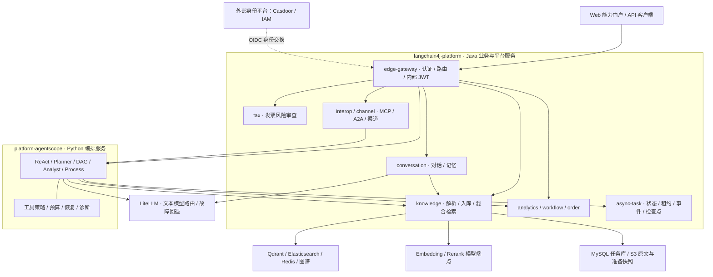

# LangChain4j × AgentScope：企业 AI 应用与多 Agent 平台

这是我围绕**企业知识库、智能客服与业务助手**持续建设的个人项目。通过 Java 微服务承载业务和数据能力，通过独立的 Python AgentScope 服务组织推理、工具调用和多 Agent 协作，并提供可交互的 Web 能力门户。

项目重点是把 AI 接入完整的业务链路：从文档上传、检索和对话，到任务规划、异步执行、失败恢复，再到身份权限、人工确认、运行诊断和评测。

**Java 21 · Spring Boot · LangChain4j · Python 3.12 · AgentScope · Vue 3 · RAG · MCP / A2A**

[能力一览](#能力一览) · [系统架构](#系统架构) · [工程实现](#工程实现) · [近期迭代](#近期迭代) · [本地运行](#本地运行) · [文档导航](#文档导航)

> 内容核对于 **2026-10-20**，以两个仓库的代码、配置和验证记录为依据。以下区分已实现能力、默认配置与需要单独启用的扩展。

## 项目定位与仓库分工

两个仓库共同组成这套作品：

| 仓库 | 职责 | 主要实现 |
| --- | --- | --- |
| **[langchain4j-platform](https://github.com/lirji/langchain4j-platform)**（本仓库） | Java 业务与平台服务 | 对话、RAG、数据分析、工作流、订单、财税、认证、异步任务、互操作、评测，以及 Web 能力门户 |
| **[platform-agentscope](https://github.com/lirji/platform-agentscope)**（本地目录 `agentscope-platform`） | Python Agent 编排服务 | ReAct、DAG、Planner、Analyst、Process、Chain / Vote / Reflexion、可恢复执行、工具治理与诊断 |

**当前默认 Agent 路径已经切换到 AgentScope。** 本仓库的 edge-gateway 与 interop-service 默认将 `/agent/**` 相关调用交给 `agentscope-orchestrator`；Python 通过 HTTP 复用 Java 领域服务。原 Java `agent-service` 保留为显式整服务回滚目标。[切换与回滚说明](docs/Agent编排/agentscope-full-cutover.md)

这套分工保留 Java 在事务、数据和业务集成中的实现，同时让 Agent 编排独立演进。AgentScope 框架类型被限制在适配器层，对外使用 HTTP / JSON / SSE 和语言中立契约。

## 能力一览

| 场景 | 已实现能力 | 主要服务与入口 |
| --- | --- | --- |
| **企业知识库** | 文件解析、选择性中英文 OCR、结构化分块、异步入库、版本发布、重复内容识别、来源定位 | `knowledge-service`：`/rag/ingestions`、`/rag/documents/**` |
| **混合检索与问答** | 向量、关键词 BM25、Elasticsearch BM25、GraphRAG 四路召回，RRF 融合、重排、查询扩展和上下文增强 | `knowledge-service` + `conversation-service`：`/rag/query`、`/chat` |
| **对话与可治理记忆** | SSE 流式、多轮记忆、意图路由、结构化抽取、模型级联；持久化用户画像及确认、修正、固定、遗忘、启停 | `conversation-service`：`/chat/stream`、`/chat/auto`、`/memory/governance` |
| **多 Agent 协作** | ReAct 工具循环、DAG 依赖编排、自动规划、结果汇总、Critic / Replan，以及串联、投票和反思 | AgentScope：`/agent/run`、`/agent/dag/plan-run`、`/agent/chain`、`/agent/vote`、`/agent/reflexive` |
| **数据分析助手** | 自然语言转 SQL、查询与结果解释；Analyst 先探表再取数，并通过 DAG 分解分析任务 | `analytics-service` + AgentScope：`/chat/sql`、`/agent/analyst/run` |
| **业务流程与订单** | Flowable 退款审批、流程状态与待办查询、按订单号只读查单；Process 可组合流程与知识证据 | `workflow-service`、`order-service` + AgentScope：`/workflow/**`、`/agent/process/run` |
| **发票风险审查** | 重复、金额、税额、期间等确定性规则；租户知识证据与 AI 辅助说明，依赖失败时降级 | `tax-service`：`/tax/invoices/review` |
| **多模态与语音** | 图像描述、视觉对话、图片向量检索；可选 ASR → 对话 → TTS 语音闭环 | `vision-service`、`voice-service`、`knowledge-service` |
| **渠道与互操作** | 钉钉 / 飞书事件桥、Webhook、MCP 工具接口、A2A Agent Card、流式消息与推送中继 | `channel-service`、`interop-service` |
| **任务与质量验证** | 中央异步任务、取消与 SSE 续订；HTTP 回归、检索质量评测、Java / Python Shadow 对比 | `async-task-service`、`eval-service`、AgentScope evaluation |

**Web 能力门户**位于 [capability-showcase-frontend](capability-showcase-frontend/README.md)，使用 Vue 3 + TypeScript + Vite。页面通过真实 API 展示对话、知识库、任务和各类能力；知识库上传已接入异步任务恢复、版本更新、重复文档提示与检索来源展示。

推荐体验顺序：**上传文档并等待 READY → 检索与对话 → 创建 Agent 任务 → 查看执行过程 → 管理记忆或体验数据分析、业务流程。**

## 系统架构



- **业务网关与模型网关分工**：edge-gateway 处理身份、业务路由和限流；LiteLLM 处理模型接入与故障回退。Embedding / Rerank 可直接使用独立模型端点。
- **跨语言身份一致**：Java 与 Python 校验内部 JWT，并传播租户、用户、权限、部门和 TraceId；模型工具参数不能覆盖调用者身份。
- **业务能力复用**：AgentScope 调用现有知识、分析、流程和订单服务；事务与业务规则仍由对应领域服务负责。
- **契约与演进**：版本化 OpenAPI / JSON Schema、契约校验、Shadow 对比和显式回滚共同约束 Java / Python 协作。

## 工程实现

### 1. 从文件到可检索知识的可靠链路

文档写入采用持久化异步任务：**接收原文 → 解析与分块 → 准备快照 → 写入检索存储 → 提交可见版本**。HTTP `202` 表示任务已接收，任务达到 `READY` 才表示入库完成；新版本准备期间，旧版本继续可查询。

- PDF、DOCX、Markdown、Excel、CSV 等主格式保留各自可提取的页码、标题、工作表或行范围，检索结果可回查来源；其他格式的支持程度见格式清单。
- 文件解析默认在独立 JVM 中执行，限制输入、正文、页数、临时盘和执行时间；PDF 选择性 OCR 默认开启，标准镜像包含本地 Tesseract 中英文语言包。
- 流式 SHA-256 识别相同文件字节，结合租户、可见权限与并发守卫处理重复上传；前端区分“已有文档”“仍在处理”“需要恢复”。
- 幂等提交、租约、准备快照、分批模型与索引写入、共享额度和租户公平调度共同约束重试与资源占用；连续上下文增强失败时跳过后续增强调用，保留原始分块。

[可靠入库协议](docs/对话与检索/可靠入库接入.md) · [格式与验证范围](docs/对话与检索/知识库文档支持范围.md) · [检索质量评测](docs/对话与检索/retrieval-quality-loop.md)

### 2. 可控的多 Agent 执行

AgentScope 将任务拆为有依赖的 DAG，由 Planner 规划、Worker 执行、Synthesis 汇总，再按配置进入 Critic / Replan。Analyst 复用这套执行引擎，先确认表结构，再调用分析服务。

优化模式按依赖就绪调度节点，限制并发、排队、总截止时间、模型调用次数和预算预留；失败依赖的后继节点跳过执行，结果明确标记不完整。只在受限条件下复用成功的只读结果，并在输入、上游版本或有效期变化时失效。

[AgentScope DAG 编排](https://github.com/lirji/platform-agentscope/blob/main/docs/dag-orchestration.md) · [其他协作模式](https://github.com/lirji/platform-agentscope/blob/main/docs/sibling-orchestrators.md)

### 3. 跨进程恢复与执行诊断

只读 DAG 的 API / worker 分离模式使用 Java 中央任务服务保存检查点，由 Python worker 领取和执行。接管时校验身份、执行版本、租约及预算；兼容的纯计算节点可恢复，工具节点及其下游重新执行以复核权限和数据，累计预算与截止时间不会重置。

诊断覆盖 Planner、Worker、Synthesis、Critic 和 Replanner，可从结构化日志、SSE 事件与指标查看节点耗时、排队、关键路径、复用或恢复原因、模型用量和费用估算。费用需要显式配置价格；未知用量、缺失记录和恢复片段不会被记成零费用。

[节点持久恢复](https://github.com/lirji/platform-agentscope/blob/main/docs/dag-recovery.md) · [DAG 诊断与成本归因](https://github.com/lirji/platform-agentscope/blob/main/docs/dag-diagnostics.md) · [会话检查点与能力注册](https://github.com/lirji/platform-agentscope/blob/main/docs/agent-sessions-and-capabilities.md)

### 4. 身份、工具与记忆治理

默认 Agent 工具包括时间、知识检索、订单查询、探表、数据分析和流程查询。可选的 `refund_start` 需要精确参数绑定的一次性确认 grant 与幂等键，只发起流程，审批仍由业务流程完成。MCP、Browser、Code 扩展需单独启用并配置工具策略或远程沙箱。

知识库可接外部 IAM 的文档级 ReBAC，支持 `disabled / shadow / enforce` 渐进启用。长期记忆持久化到关系库，新抽取内容经用户确认后进入召回；用户可以修正、固定、遗忘和停用记忆，并查看操作记录。

[受治理工具](https://github.com/lirji/platform-agentscope/blob/main/docs/governed-tools.md) · [身份与文档授权](docs/平台工程/rbac-and-public-kb.md) · [可治理记忆](docs/对话与检索/memory-guide.md)

### 5. 工程验证与可追溯交付

Java 侧采用 MyBatis-Plus + Mapper XML、版本化数据库迁移和跨服务 DTO；Python 侧隔离框架适配层并执行类型检查。两个仓库包含聚焦测试、契约校验、故障与恢复验证，以及旧 / 新 Agent Shadow 评测工具。

CI 配置包含构建、测试和供应链检查，可信发布流程提供 SBOM、镜像扫描、签名及按 digest 回滚入口。本仓库另包含 Coding Agent 工作规范、GoldenCase 回放工具和离线 Java 代码图，便于将实现、影响分析、评审和验证与代码证据关联。

[持久化规范](docs/平台工程/mybatis-plus-persistence.md) · [数据库迁移](docs/平台工程/database-migrations.md) · [可信发布](docs/平台工程/software-supply-chain.md) · [Coding Agent 工程](docs/平台工程/coding-agent-playbook.md)

## 近期迭代

截至 2026-10-20，两个仓库近期已落地的重点包括：

| 方向 | 更新内容 | 记录 |
| --- | --- | --- |
| 文档解析 | 结构化来源、独立解析进程、资源预算、中英文选择性 OCR，以及补充格式样本验证 | [解析与支持范围](docs/对话与检索/知识库文档支持范围.md) |
| 知识库体验 | 异步上传、未知结果恢复、任务重试、新版本上传、解析告警与来源展示 | [前端说明](capability-showcase-frontend/README.md) |
| 重复与失败处理 | 相同文件内容去重、已有文档提示、并发提交保护，以及连续增强失败后的调用收敛 | [内容去重](docs/delivery/knowledge-content-dedup/PROGRESS_STATE.md) · [增强失败保护](docs/delivery/ingestion-context-failfast/PROGRESS_STATE.md) |
| 记忆与知识运营 | 持久化画像、用户确认与修正、来源同步及审核发布能力 | [记忆与知识运营记录](docs/delivery/memory-knowledge-operations/PROGRESS_STATE.md) |
| Agent 执行 | DAG 优化调度、只读节点持久恢复、角色级模型用量与运行诊断 | [恢复说明](https://github.com/lirji/platform-agentscope/blob/main/docs/dag-recovery.md) · [诊断说明](https://github.com/lirji/platform-agentscope/blob/main/docs/dag-diagnostics.md) |

## 技术栈与代码组织

以下是**仓库采用的版本**，不表示上游项目的最新发行版：

| 层次 | 技术 |
| --- | --- |
| Java 服务 | Java 21、Spring Boot **3.3.5**、Spring Cloud **2023.0.3**、LangChain4j **1.13.1**（MCP 模块 `1.13.1-beta23`） |
| Agent 编排 | Python 3.12、AgentScope **2.0.5**、FastAPI、Pydantic、HTTPX、uv |
| Web 门户 | Vue 3、TypeScript、Vite、Pinia、Vue Router |
| 数据与流程 | MyBatis-Plus **3.5.17** + Mapper XML、MySQL、PostgreSQL、Redis、Flowable、Flyway |
| 检索与文件 | Qdrant、Elasticsearch BM25、HanLP、Apache Tika、Tesseract、S3 兼容对象存储；支持多种向量存储 provider |
| 模型与协议 | LiteLLM、OpenAI-compatible 接口、MCP、A2A、HTTP / JSON / SSE |
| 工程与运行 | Maven、JUnit、pytest、Ruff、mypy、Vitest、Docker Compose、Helm、OpenTelemetry、Prometheus；可选 Kafka 事件总线 |

版本依据：[根 POM](pom.xml)、[前端依赖](capability-showcase-frontend/package.json)、[AgentScope 依赖声明](https://github.com/lirji/platform-agentscope/blob/main/pyproject.toml)。

```text
langchain4j-platform/
├── edge-gateway/                 # 统一业务入口与身份交换
├── conversation-service/         # 对话、记忆、路由与模型级联
├── knowledge-service/            # 文档入库、混合检索与知识运营
├── analytics-service/            # NL2SQL / ChatBI
├── workflow-service/             # Flowable 业务流程
├── order-service/                # 租户订单查询
├── tax-service/                  # 发票风险审查
├── async-task-service/           # 中央任务、事件、租约与检查点
├── auth-service/                 # 自建账号与 RBAC
├── channel-service/             # 外部渠道适配
├── interop-service/              # MCP / A2A 互操作
├── eval-service/                 # 回归评测
├── vision-service/              # 视觉理解
├── voice-service/               # 语音闭环
├── agent-service/               # Java Agent 回滚实现
├── platform-*/                  # 持久化、安全、观测、协议、审计等共享库
├── database-migrations/         # 数据库版本迁移
├── config-server/               # 可选配置服务
├── capability-showcase-frontend/ # Web 能力门户
├── deploy/                      # Compose、Helm、启停与验证脚本
└── docs/                        # 专题设计、运行手册和验证记录

agentscope-platform/             # 独立仓库：lirji/platform-agentscope
└── src/agentscope_platform/
    ├── api/                     # FastAPI 路由与外部契约
    ├── application/             # 编排、调度、预算、恢复与工具策略
    ├── domain/                  # 框架无关的领域模型
    ├── infrastructure/          # AgentScope、HTTP、安全与观测适配器
    └── evaluation/              # Shadow 对比与评测工具
```

## 本地运行

### 准备环境

- Java 21、Maven、Docker 与 Docker Compose；独立运行 Python 服务时准备 Python 3.12 和 uv，前端开发另需 Node.js / npm。
- 将两个项目放在同级目录，AgentScope 克隆目录命名为 `agentscope-platform`，供现有启动脚本发现。
- 构建需要外部 [auth-platform](https://github.com/lirji/auth-platform) 的固定版本 IAM SDK；该依赖尚未发布到公共 Maven 仓。默认门户登录还需要配置 Casdoor 的组织、应用和回调地址，详见 [SSO 接入](docs/平台工程/公网化-OIDC-改造方案.md)。
- 准备模型凭据。标准启动脚本通过 `deploy/.env` 中的 `BAILIAN_CREDENTIAL_CSV` 读取本地百炼凭据文件；模型网关和其他运行配置见 [环境模板](deploy/.env.example)。

```bash
# 在同一个父目录下克隆项目和构建依赖
git clone https://github.com/lirji/langchain4j-platform.git
git clone https://github.com/lirji/platform-agentscope.git agentscope-platform
git clone https://github.com/lirji/auth-platform.git
cd langchain4j-platform

# 使用仓库锁定的 IAM SDK 版本，核对跨语言契约
bash deploy/install-auth-sdk.sh
bash deploy/sync-agent-contracts.sh

# 首次创建本机配置，再按上文填写模型与身份配置
cp -n deploy/.env.example deploy/.env

# 构建 Java、AgentScope 镜像与前端，并启动本地整栈
bash deploy/start-all.sh
```

已有共享基础设施时，先按 [dev-infra 接入指南](deploy/dev-infra/README.md)完成资源配置，再使用 `bash deploy/start-all.sh --dev-infra`。前端热更新入口为 `bash deploy/start-dev.sh --dev-infra`，同样需要先完成基础设施配置。

| 入口 | `start-all.sh` 默认宿主地址 |
| --- | --- |
| Web 能力门户 | `http://localhost:8093` |
| 统一业务 API | `http://localhost:18080` |
| AgentScope 健康检查 | `http://localhost:18085/health` |

端口可被环境变量或中央端口注册表覆盖，以启动脚本输出为准；基础 Compose 的网关默认映射是 `8080`，启动脚本默认改为 `18080`。

**默认认证为 Casdoor-only**：`EDGE_CASDOOR_ENABLED=true`、`EDGE_CASDOOR_MODE=only`。业务请求使用有效的 Casdoor Bearer Token；旧 API Key / 自建会话路径需要按运行手册显式选择兼容配置。

### 开发验证入口

下列为项目验证命令，需先完成对应依赖准备；模型质量与外部服务集成另按专项手册验证。

```bash
# Java：聚焦模块及其上游依赖；完整回归使用 mvn test
mvn -pl knowledge-service -am test

# Web 门户
cd capability-showcase-frontend
npm ci
npm run type-check
npm test
npm run build
cd ..

# AgentScope
cd ../agentscope-platform
uv sync --dev
uv run python scripts/export_contracts.py --check
uv run ruff check .
uv run mypy src
uv run pytest
```

## 当前边界

- **默认开放与可选扩展**：AgentScope 默认工具只读；退款发起、MCP 客户端和 Browser / Code 远程沙箱需要单独配置。视觉服务默认开启，语音和文档级 ReBAC 默认关闭。
- **恢复模式有明确前置条件**：DAG 节点恢复在 `ASYNC_TASK_ROLE=api/worker` 下默认开启；基础 Compose 使用的 inline 模式不因此自动获得节点持久恢复。需先完成中央迁移并采用 [只读 worker 部署配置](deploy/docker-compose.readonly-worker.yml)。
- **解析与检索的覆盖可查证**：内容去重比较原文件字节；不同编码、格式或重新保存的文件可能仍不同。OCR 样本验证不代表复杂版面、手写或所有扫描件都能完整提取。
- **发布状态**：仓库包含本机部署与故障恢复验证记录。生产容量、模型效果和供应链发布仍需按具体环境验收，当前默认路由与本地运行记录不构成生产上线结论。

## 文档导航

| 想了解的内容 | 入口 |
| --- | --- |
| 平台全貌与业务场景 | [文档首页](docs/README.md) · [能力文档](docs/参考/capabilities.md) · [业务场景](docs/scenarios.md) |
| 架构与技术选择 | [架构说明](docs/参考/架构文档.md) · [框架选型讨论](docs/平台工程/AI框架选型与LangChain4j评估-20261020.md) |
| RAG、记忆与数据分析 | [RAG](docs/对话与检索/rag-guide.md) · [可靠入库](docs/对话与检索/可靠入库接入.md) · [记忆](docs/对话与检索/memory-guide.md) · [NL2SQL](docs/对话与检索/nl2sql-guide.md) |
| AgentScope 设计与运行 | [仓库首页](https://github.com/lirji/platform-agentscope) · [架构](https://github.com/lirji/platform-agentscope/blob/main/docs/architecture.md) · [异步编排](https://github.com/lirji/platform-agentscope/blob/main/docs/async-orchestration.md) |
| 工作流、财税与多模态 | [工作流](docs/Agent编排/workflow-guide.md) · [发票审查](docs/财税/tax-invoice-risk-review.md) · [视觉](docs/多模态语音/vision-guide.md) · [语音](docs/多模态语音/voice-guide.md) |
| 身份、协议与渠道 | [SSO / RBAC](docs/平台工程/rbac-and-public-kb.md) · [MCP](docs/互操作渠道/mcp-guide.md) · [A2A](docs/互操作渠道/a2a-guide.md) · [钉钉](docs/互操作渠道/dingtalk-guide.md) |
| 开发、部署与验证 | [开发指南](docs/参考/developer-guide.md) · [部署指南](docs/平台工程/deployment-guide.md) · [dev-infra](deploy/dev-infra/README.md) · [可信发布](docs/平台工程/software-supply-chain.md) |

部分历史专题记录的是旧 Java Agent 的实现过程；当前 Agent 默认路由以本页、[切换手册](docs/Agent编排/agentscope-full-cutover.md)及 [AgentScope 仓库](https://github.com/lirji/platform-agentscope)为准。
